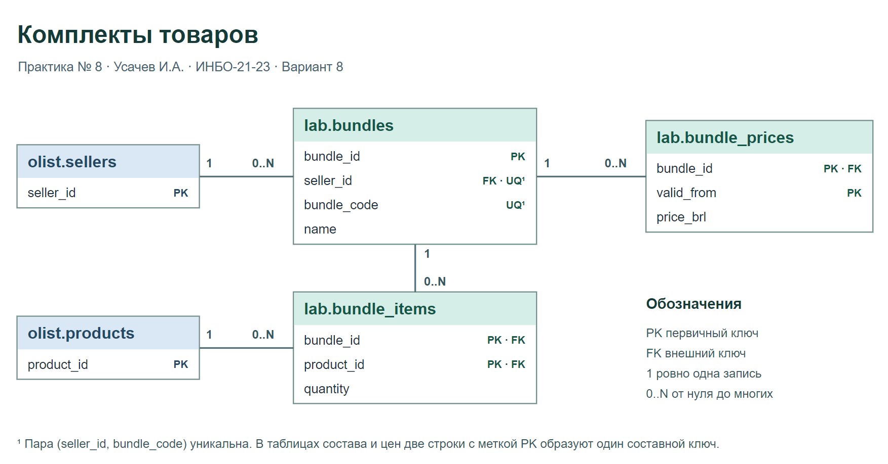

# МОСУД Практическая работа 8

**ER-модель комплектов товаров. Вариант 8.**

Усачев И.А., группа ИНБО-21-23. Продавец Olist может объединить несколько товаров в комплект, задать количество каждого товара и менять цену комплекта с определённой даты. Модель реализована в схеме `lab` на PostgreSQL 17. [SQL с тестовыми данными](lab08.sql) · [Исходник диаграммы для diagrams.net](erDiagram.drawio)

## Сущности и связи

| Связь | Обязательность участия |
| --- | --- |
| Продавец → комплекты | У продавца может быть 0..N комплектов. У каждого комплекта ровно один продавец |
| Комплект → строки состава | В комплекте может быть 0..N строк. Каждая строка принадлежит одному комплекту |
| Товар → строки состава | Товар может встречаться в 0..N комплектах. Каждая строка состава указывает один товар |
| Комплект → цены | У комплекта может быть 0..N записей цены. Каждая запись относится к одному комплекту |

Таблица `bundle_items` реализует связь M:N между комплектами и товарами. Количество относится к паре «комплект — товар». Например, один и тот же товар входит в `L08-01` в количестве двух единиц, а в `L08-02` — одной. Модель позволяет создать карточку комплекта до заполнения состава и цены.

## Бизнес-правила и ограничения

| № | Бизнес-правило | Что его обеспечивает |
| --- | --- | --- |
| 1 | Каждый комплект имеет собственный идентификатор и одного существующего продавца Olist | `pk_bundles`, `IDENTITY`, `seller_id NOT NULL`, `fk_bundles_seller` |
| 2 | Код уникален у продавца. В нём допустимы группы заглавных латинских букв и цифр, разделённые дефисом | `uq_bundles_seller_code`, `ck_bundles_code`, `bundle_code NOT NULL` |
| 3 | Название содержит хотя бы один непробельный символ | `ck_bundles_name`, `name NOT NULL` |
| 4 | Строка состава относится к существующему комплекту и существующему товару Olist | `fk_bundle_items_bundle`, `fk_bundle_items_product` |
| 5 | Для каждого товара в комплекте указывается одно положительное целое количество | Составной `pk_bundle_items`, тип `integer`, `quantity NOT NULL`, `ck_bundle_items_quantity` |
| 6 | Для комплекта на одну дату начала можно записать только одну цену | `fk_bundle_prices_bundle`, составной `pk_bundle_prices` по `(bundle_id, valid_from)` |
| 7 | Цена задаётся в бразильских реалах с точностью до сентаво и должна быть положительным денежным значением | `numeric(10,2)`, `price_brl NOT NULL`, `ck_bundle_prices_amount`, включая проверку на `NaN` |
| 8 | При удалении комплекта удаляются его состав и история цен | `ON DELETE CASCADE` у двух внешних ключей на `lab.bundles` |

Для цены хранится дата начала действия. Цена на выбранный день — последняя запись с `valid_from`, меньшей или равной этому дню. До первой записи цена неизвестна. Для нескольких изменений в течение дня понадобилась бы другая точность даты.

## Тестовые данные

Скрипт выбирает по идентификатору первого продавца Olist как минимум с пятью разными товарами в `order_items`, затем берёт пять его товаров. Идентификаторы продавца и товаров взяты из реальных продаж. Названия комплектов, их состав и цены заданы для упражнения. Оба справочника остаются в схеме `olist`.

Добавлены **5 комплектов, 10 строк состава и 6 записей цен**. В каждом комплекте два разных товара, каждый из пяти товаров входит в два комплекта. У комплекта `L08-01` на 31 января 2026 года действует цена **99,90 BRL**, а с 1 февраля — **109,90 BRL**.

## Ошибочные изменения

В конце SQL приведены четыре закомментированных оператора. Для каждого указано ограничение, которое отклоняет изменение.

| Операция | Ожидаемое ограничение |
| --- | --- |
| Установить количество товара равным нулю | `ck_bundle_items_quantity` |
| Добавить вторую цену комплекта с тем же днём начала | `pk_bundle_prices` |
| Включить в комплект отсутствующий в Olist товар | `fk_bundle_items_product` |
| Повторить код комплекта у того же продавца | `uq_bundles_seller_code` |

## Контрольные вопросы

**1. Когда связь M:N требует отдельной таблицы?**

Когда каждый объект с обеих сторон может иметь несколько соответствий. В `bundle_items` строка хранит одну пару `(bundle_id, product_id)` и её количество. Составной первичный ключ обеспечивает уникальность пары.

**2. Чем естественный ключ отличается от суррогатного?**

Естественный ключ имеет смысл для предметной области. В этой модели продавец различает свои комплекты по коду, поэтому пара `(seller_id, bundle_code)` служит альтернативным ключом. Суррогатный `bundle_id` генерирует PostgreSQL. Строки состава и цен ссылаются на него даже при изменении кода.

**3. Какие ограничения лучше реализовывать декларативно?**

Обязательность значения выражается через `NOT NULL`, уникальность — через `PRIMARY KEY` и `UNIQUE`, существование связанных объектов — через `FOREIGN KEY`. Для условий одной строки подходит `CHECK`. Так база проверяет положительное количество при каждой вставке и при каждом изменении.

## Результат

На GitHub диаграмма видна прямо в этом README. Для показа работы PostgreSQL открой успешный запуск с практикой № 8 и найди `lab08/lab08.sql` на странице **Summary**. Сначала выводятся ограничения и столбцы из системного каталога, затем число учебных записей, состав комплектов и цена на три даты. [Результаты SQL в GitHub Actions](https://github.com/PurpurSmagic/mosud-course/actions/workflows/sql-results.yml)

## Выполненная проверка

На PostgreSQL 17 проверены три таблицы и двенадцать именованных ограничений. Все четыре ошибочных оператора проверены отдельно и отклонены ожидаемыми ограничениями. При повторном запуске сохранились исходные идентификаторы комплектов и количества строк **5 / 10 / 6**. Состав сверён с исходным CSV позиций заказов Olist. Успешный скрипт завершает транзакцию командой `COMMIT`.
